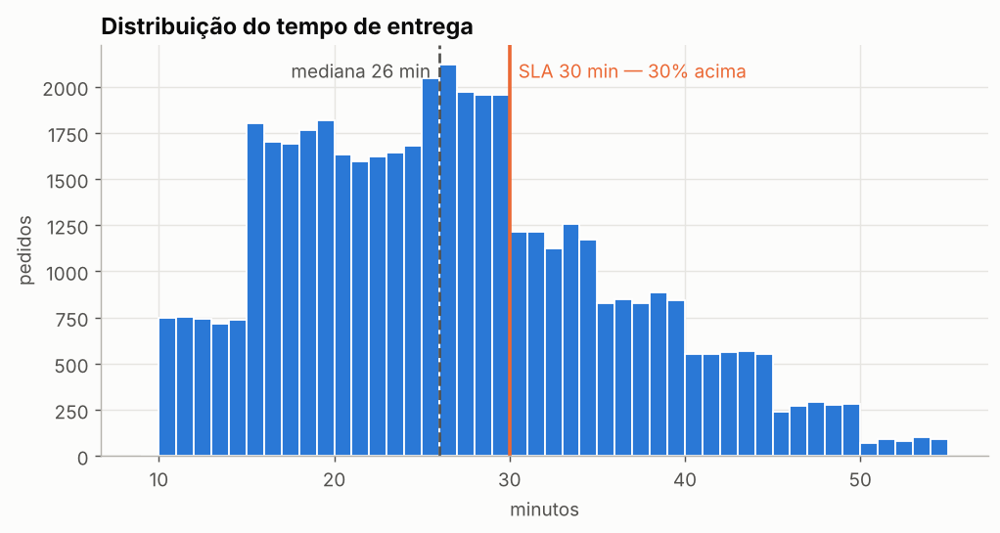
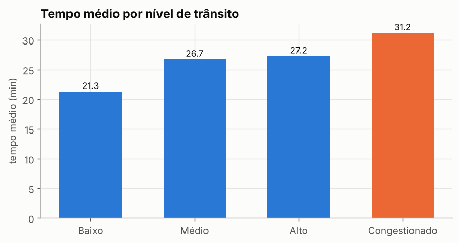
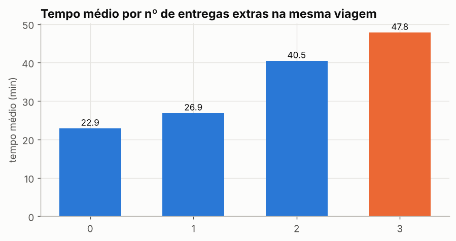
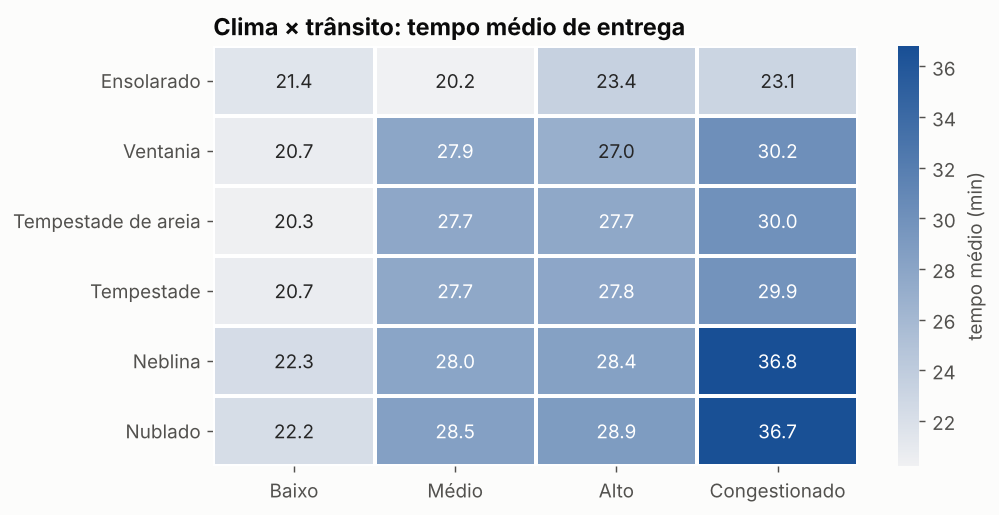
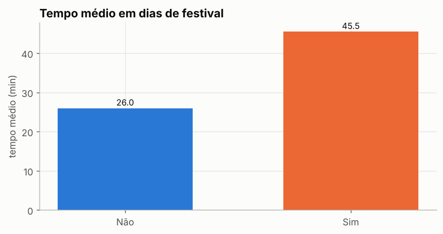
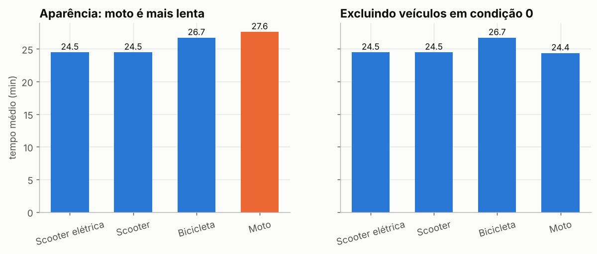
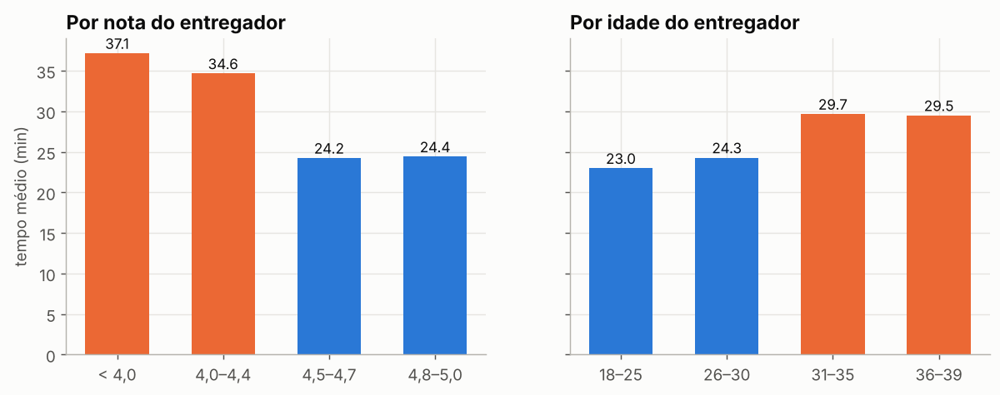
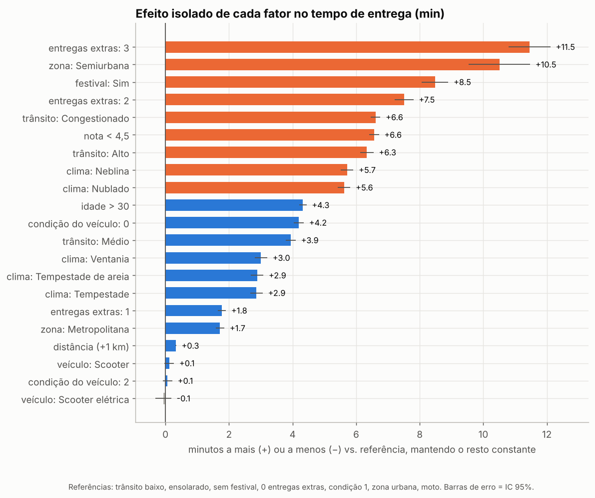

# 🛵 O que realmente atrasa uma entrega? — Análise de 45 mil pedidos de delivery

Análise de ponta a ponta (limpeza → exploração → testes estatísticos → análise multivariada → recomendações) do **[Food Delivery Dataset](https://www.kaggle.com/datasets/gauravmalik26/food-delivery-dataset)** do Kaggle: 45.593 pedidos em 22 cidades da Índia, fev–abr/2022.

📓 **Notebook completo:** [`analise_delivery.ipynb`](analise_delivery.ipynb)

---

## Principais resultados

| | |
|---|---|
| ⏱️ **30%** dos pedidos passam de 30 min | 🎉 **+75%** de tempo em dias de festival, 100% fora do SLA |
| 📦 **2+ entregas agrupadas** quase dobram o tempo | 🛵 A moto **não** é mais lenta — o **veículo em mau estado** é |
| 🌫️ **Neblina** pesa mais que tempestade | 🏙️ Cidade e tipo de pedido **não** influenciam o tempo |

## Perguntas de negócio

1. Qual é o tempo típico de entrega e quantos pedidos estouram uma promessa de 30 minutos?
2. Quais fatores operacionais (trânsito, distância, entregas agrupadas) mais pesam?
3. Fatores externos (clima, festivais) importam? Quanto?
4. A frota e o perfil do entregador influenciam o resultado?
5. Qual é o efeito de cada fator quando os demais são mantidos constantes?

---

## 1. Limpeza de dados

A base original tem **10 tipos de problemas** de qualidade, todos tratados em [`src/limpeza.py`](src/limpeza.py):

| Problema | Exemplo | Tratamento |
|----------|---------|------------|
| Nulos gravados como texto | `"NaN "` | Converter para nulo real |
| Espaços extras | `"Snack "` | `strip()` |
| Alvo com prefixo | `"(min) 24"` | Regex |
| Clima com prefixo | `"conditions Sunny"` | Remover prefixo |
| Números como texto | idade, nota | `to_numeric` |
| **Perfis de teste** (nota 6 numa escala 1–5, idade 15) | 91 linhas | Removidos |
| Latitudes negativas (erro de sinal) | `-15.30` | Valor absoluto |
| Coordenadas zeradas | `0.0` | Marcadas como ausentes |
| Pedidos que viram a meia-noite | 23:55 → 00:05 | +1 dia na coleta |
| Cidade escondida no ID do entregador | `INDORES13DEL02` | Extraída (`INDO`) |

**Achado na limpeza:** os nulos não são aleatórios. Quando falta a idade do entregador, a nota falta em 100% dos casos e o horário do pedido em 88% — um bloco de ~1,8 mil pedidos com cadastro incompleto. Como o tempo de entrega desse bloco é igual ao do resto, as linhas foram mantidas.

Atributos criados: distância (Haversine), tempo de preparo, hora do dia, dia da semana e cidade.

---

## 2. Principais achados

### Quase 1 em cada 3 pedidos estoura 30 minutos


### Trânsito: de 21 para 31 minutos — e de 8% para 51% fora do SLA


> ⚠️ Na base, o trânsito é praticamente **determinado pelo horário** (manhã = sempre baixo; 18–20h = congestionado). Os dois carregam a mesma informação. O pico de demanda (18h–23h) coincide com o pior trânsito.

### Agrupar entregas tem um custo alto


Com 2 ou 3 entregas extras na viagem, o tempo vai de ~23 para 40–48 min e **100%** dos pedidos ficam fora do SLA, em qualquer nível de trânsito.

### Clima amplifica o trânsito


Dias ensolarados são ~7 min mais rápidos. Neblina + congestionamento chega a ~37 min.

### Festivais: o pior cenário


Em dias de festival o tempo médio salta de 26 para 46 min, **mesmo com trânsito baixo (42 min)** — o gargalo é falta de entregadores, não a rua.

### A moto não é o problema: o veículo em mau estado é


Todos os veículos em condição 0 (pior estado) são motos. Comparando veículos na mesma condição, moto, scooter e scooter elétrica **empatam**. Um caso clássico de variável de confusão.

### Entregadores: efeitos em "degrau"


Nota abaixo de 4,5 → ~10 min a mais. Idade acima de 30 → ~6 min a mais. Atenção: a nota pode ser *consequência* do atraso, não causa.

### O que **não** importa
Tipo de pedido (lanche, refeição, bebida, buffet), cidade, dia da semana e tempo de preparo: efeito estatisticamente desprezível. A distância importa menos do que se imagina (~0,3 min por km).

---

## 3. Testes estatísticos

Como o tempo não segue distribuição normal, foram usados **Kruskal-Wallis** (com tamanho de efeito ε²) e **Spearman**. Com 45 mil linhas quase tudo é "significativo", então o foco é o tamanho do efeito:

| Força do efeito | Variáveis |
|---|---|
| Grande | trânsito, entregas múltiplas |
| Média | distância, idade, nota, condição do veículo, clima |
| Pequena | zona, festival (raro, mas enorme por pedido), tipo de veículo |
| Desprezível | dia da semana, cidade, tipo de pedido, tempo de preparo |

---

## 4. Análise multivariada

Os fatores se misturam (dias de festival também têm mais trânsito e mais agrupamento). Uma regressão linear (OLS) separa quantos minutos cada fator adiciona **mantendo os demais constantes** (R² = 0,64):



- Maiores agravantes: **3 entregas extras (+11,5 min)**, **festival (+8,5)** e **2 entregas extras (+7,5)**.
- No festival, o efeito isolado é menos da metade da diferença bruta (+20 min): parte do atraso vem de mais agrupamento, trânsito e clima.
- O **tipo de veículo** tem efeito zero quando a condição do veículo é controlada.

---

## 5. Recomendações

1. **Calendário de festivais → plano de capacidade:** reforçar a frota e ajustar a promessa de prazo nesses dias.
2. **Limitar o agrupamento a 1 pedido extra** no pico e em clima ruim.
3. **Manutenção da frota:** recuperar/substituir veículos em condição 0 em vez de trocar o tipo de veículo.
4. **Roteamento sensível a clima:** com neblina + trânsito pesado, reduzir raio e agrupamento.
5. **Acompanhar entregadores com nota < 4,5** (treinamento, não punição automática).
6. **Prazo prometido por cenário:** ampliar a promessa nos cenários críticos (festival, 2+ entregas extras, neblina com trânsito pesado).

## Limitações

- **Sinais de dados semissintéticos:** trânsito definido pela hora, efeitos em degrau, tempo de preparo com só 3 valores, tempos em degraus de 5 min, mesma proporção de zonas em todas as cidades. O método vale; as conclusões precisariam ser validadas com dados reais.
- Distância em linha reta, não a rota real.
- Período curto (2 meses) e dados observacionais (associação ≠ causalidade).

---

## Estrutura do repositório

```
food-delivery-analysis/
├── analise_delivery.ipynb      # análise completa, executada
├── src/
│   ├── limpeza.py              # pipeline de limpeza e features
│   └── graficos.py             # estilo visual dos gráficos
├── data/
│   ├── raw/food_delivery.csv           # base original (Kaggle)
│   └── processed/food_delivery_limpo.csv
├── images/                     # gráficos exportados
└── requirements.txt
```

## Como reproduzir

```bash
git clone https://github.com/magdielarruda03-beep/food-delivery-analysis.git
cd food-delivery-analysis
pip install -r requirements.txt
jupyter notebook analise_delivery.ipynb
```

## Tecnologias

Python · pandas · NumPy · SciPy · statsmodels · Matplotlib · seaborn

---

**Dados:** [Food Delivery Dataset — Gaurav Malik, Kaggle](https://www.kaggle.com/datasets/gauravmalik26/food-delivery-dataset). Os direitos sobre os dados pertencem ao autor original.
